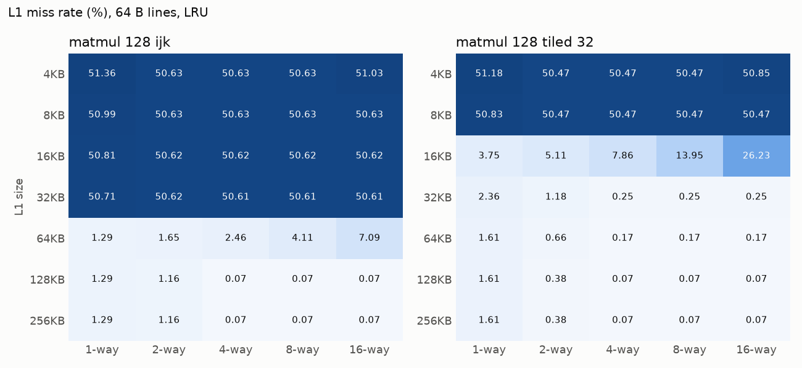

# Cache Simulator

A trace-driven cache and memory-hierarchy simulator in C++17 that compares replacement policies, a stride prefetcher and L1/L2 hierarchies on synthetic and real program traces.

| Miss rate (16 KB, 4-way, 64 B lines) | LRU | SRRIP | BRRIP |
|---|---:|---:|---:|
| 64×64 matmul, `ijk` | 4.90% | 4.34% | 6.83% |
| 64×64 matmul, 16×16 tiles | 0.32% | 0.32% | 0.33% |
| Two passes over 2× cache size | 100.00% | 100.00% | 81.45% |
| 8 KB hot set + 16 KB scans | 75.00% | 51.25% | 51.25% |

On six real programs traced with Valgrind, SRRIP stays within 0.05 cycles of LRU, BRRIP loses on every program, and a degree-4 stride prefetcher cuts grep's AMAT from 9.09 to 6.74 cycles ([docs/traces.md](docs/traces.md)).



128×128 matmul, LRU: `ijk` misses half its accesses until the L1 holds a whole matrix, and more ways can raise the miss rate ([docs/figures.md](docs/figures.md)).

## Why it matters

Replacement, prefetching and hierarchy depth decide how often a core waits on DRAM. A small, readable simulator makes each policy's trade-off measurable on identical traces and explains why a policy wins on one access pattern and loses on another.

## Quick start

```sh
make check                                    # unit tests + smoke run (LRU must miss every access)
python3 tools/gen_trace.py matmul --n 64 --order ijk > build/ijk.trace
./build/cachesim --size 16K --ways 4 --line 64 --policy srrip build/ijk.trace
./build/cachesim --l2-size 256K --l2-ways 8 --prefetch 4 build/ijk.trace   # L1+L2, prefetcher
./build/cachesim --size 4K --ways 4 --events build/ijk.events build/ijk.trace   # per-access set dump
tools/real_traces.sh                          # real-program table; needs Valgrind
```

Trace format: one access per line, `R <hex address>` or `W <hex address>`; `#` starts a comment.

## Repository layout

| Path | Contents |
|---|---|
| `src/cache.{hpp,cpp}` | Set-associative write-back, write-allocate cache; LRU, SRRIP, BRRIP |
| `src/hierarchy.{hpp,cpp}` | L1/L2 hierarchy with latencies and AMAT |
| `src/prefetcher.hpp` | Global stride prefetcher |
| `src/main.cpp` | `cachesim` command-line interface |
| `tools/` | Synthetic trace generator, Valgrind Lackey converter, real-trace script, figure scripts |
| `tests/` | Hand-checked unit tests |
| `docs/` | Per-feature notes with measured tables |

## Results and verification

| Note | Contents |
|---|---|
| [RRIP replacement](docs/rrip.md) | SRRIP and BRRIP against LRU on matmul and scan traces |
| [L1/L2 hierarchy and AMAT](docs/hierarchy.md) | Miss rates and AMAT with and without an L2 |
| [Stride prefetcher](docs/prefetch.md) | Accuracy, coverage and lateness by trace and degree |
| [Real program traces](docs/traces.md) | gzip, bzip2, xz, sort, grep and Python under every policy |
| [Figures](docs/figures.md) | Per-access set view and size × associativity heatmap, with the scripts that draw them |

Every number comes from a `cachesim` run. `make check` runs the unit tests (hand-checked hit, miss, writeback, AMAT and prefetch sequences for every policy) and a smoke run that must report a 100.00% LRU miss rate.

## Limitations

- Timing is a blocking-core AMAT model: no overlap of misses, no bandwidth limit, no MSHRs.
- Traces carry no PC, so the prefetcher tracks one global stride stream.
- Levels are non-inclusive; L1 writebacks into L2 are free.
- Real traces are data accesses only (instruction fetches dropped) and include program start-up.

## Related projects

- [rv32i-pipeline](https://github.com/NicholasUnruh/rv32i-pipeline): five-stage RISC-V core with a direct-mapped instruction cache on an FPGA
- [cuda-gemm](https://github.com/NicholasUnruh/cuda-gemm): SGEMM tiling for the GPU memory hierarchy, timed against cuBLAS
- Portfolio: https://genwealth.world

## License

MIT. See [LICENSE](LICENSE).
