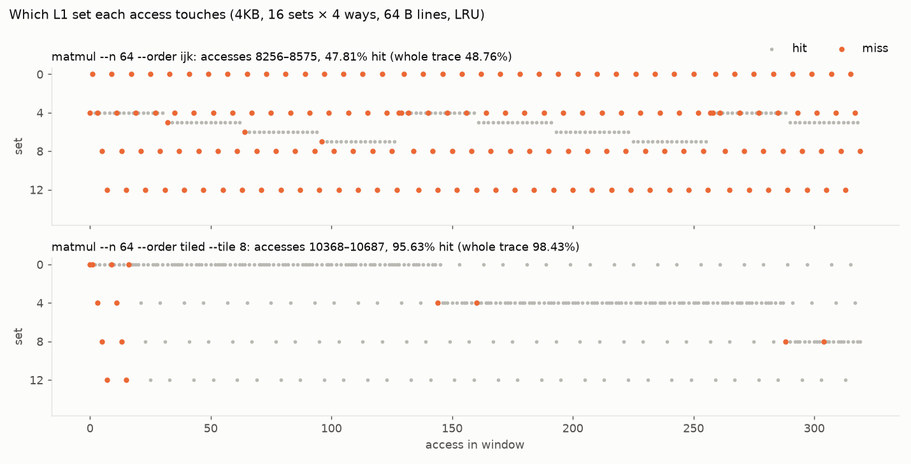
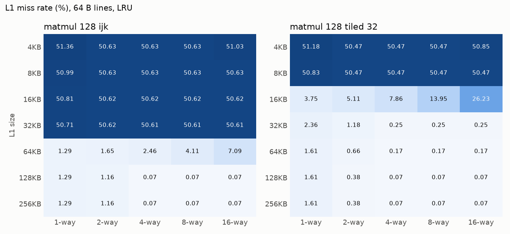

# Figures

Every figure in `docs/img` is drawn from `cachesim` output. Regenerate them from the repo root:

```sh
make build/cachesim
python3 tools/cache_steps.py --order ijk --start 8256 --count 320 > build/cache-steps-ijk.json
python3 tools/cache_steps.py --order tiled --tile 8 --start 10368 --count 320 > build/cache-steps-tiled.json
python3 tools/sweep.py heatmap > build/heatmap.json
python3 tools/sweep.py features > build/features.json
uv run --with matplotlib python tools/plot.py docs/img
```

## Set conflicts, access by access

`cachesim --events FILE` writes one line per access with L1's set, tag, hit or miss, the evicted tag and the set's tags after the access. `tools/cache_steps.py` turns a window of those lines into JSON.



4 KB L1, 16 sets × 4 ways, 64 B lines, LRU; 64×64 matmul. Window: 320 accesses from the start of row `i = 1` (`ijk`) and of the tenth 8×8 tile block (tiled).

- **`ijk`**: B is read down a column with a 256 B row stride, so its 64 lines land in only 4 of the 16 sets (0, 4, 8, 12): 16 ways for a 64-line column. Every B read misses; the window hits 47.81%, the whole trace 48.76%.
- **tiled (8×8)**: the A, B and C tiles fit, so misses cluster where a new tile is first touched. The window hits 95.63%, the whole trace 98.43%.

## Size × associativity



128×128 matmul, tiles 32×32, 64 B lines, LRU.

- **`ijk`** misses about half of all accesses until the L1 reaches 64 KB, the size of one matrix: below that, capacity decides and associativity barely moves the rate.
- **More ways can hurt.** At 16 KB, tiled misses 3.75% direct-mapped and 26.23% at 16 ways; at 64 KB, `ijk` goes from 1.29% to 7.09%. This is LRU's cyclic-reuse failure (the 2-pass row in [rrip.md](rrip.md)): when a set's lines are reused in a loop slightly longer than its ways, LRU evicts each one just before its reuse, and pooling more lines into fewer, wider sets makes that loop the common case.
