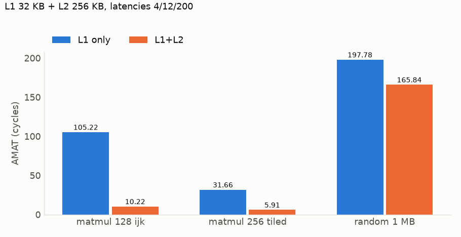

# L1/L2 hierarchy and AMAT

`--l2-size 256K --l2-ways 8` puts an L2 behind L1; `--l1-lat`, `--l2-lat`, `--mem-lat` set latencies in cycles (defaults 4, 12, 200). Blocking core: an access costs the L1 latency, plus the L2 latency on an L1 miss, plus the memory latency on an L2 miss.

Levels are non-inclusive: a miss fills every level it passed, and a dirty L1 victim is written into L2 off the critical path (free). So L2 sees L1 misses (reads) and L1 writebacks (writes); its miss rate is local, over both.

L1 32 KB 8-way, L2 256 KB 8-way, 64 B lines, LRU, latencies 4/12/200. Matmul on n×n floats (n = 128: 64 KB per matrix; n = 256: 256 KB), tiles 32×32. `random`: 2 M reads over 1 MB.

| Trace | L1 miss | L2 miss | AMAT, L1 only | AMAT, L1+L2 |
|---|---:|---:|---:|---:|
| n=128 `ijk` | 50.61% | 0.14% | 105.22 | 10.22 |
| n=128 `ikj` | 2.11% | 2.29% | 8.22 | 4.35 |
| n=128 tiled | 0.25% | 20.91% | 4.49 | 4.17 |
| n=256 `ijk` | 50.31% | 4.07% | 104.63 | 14.14 |
| n=256 `ikj` | 2.10% | 8.00% | 8.19 | 4.57 |
| n=256 tiled | 13.83% | 0.81% | 31.66 | 5.91 |
| `random` 1 MB | 96.89% | 77.52% | 197.78 | 165.84 |

- **`ijk`**: B is read down a column. A 512 B (n=128) row stride maps every B line to one of 8 L1 sets, 64 lines for a 128-line column, so every B read misses (50%). B fits in L2, which turns a 200-cycle miss into 12: AMAT falls 10×.
- **n=256 tiled**: with 1 KB rows, the A, B and C tiles (64 lines each) land in 8 to 16 of the 64 L1 sets: conflict misses again, absorbed by L2.
- **n=128 tiled**: L1 already hits; the L2 misses are the compulsory ones, so its 21% local rate costs little.
- **`random`**: 1 MB overflows both levels; L2 hits only 22% and saves 16% of AMAT.
