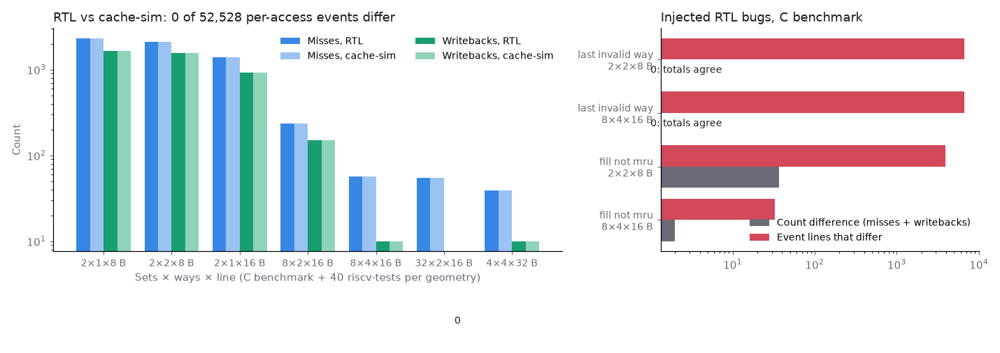

# Validating cachesim against a hardware cache, access by access

## Question

Does cachesim's L1 make the same decision as a real hardware cache on every access: hit or miss, which line it evicts, whether that line was dirty, and where the new line goes?

## Concept

**Differential testing.** Two independent implementations of one specification run the same input. Agreement does not prove both correct, but each disagreement exposes a bug in one of them, and independently written code rarely shares a bug. The specification here: set-associative, write-back, write-allocate, LRU, and a miss fills the first invalid way before evicting anything.

**Write-back, write-allocate.** A store marks its line dirty instead of writing memory; memory is updated only when a dirty line is evicted (a writeback). A store that misses first brings the line in. So writebacks depend on the entire history of stores to a set, which makes them a sensitive thing to compare.

**Events, not totals.** Two caches can miss equally often while placing lines in different ways. Comparing each access's evicted tag and the set's tags afterwards checks placement and LRU order as well.

## What I tried

The data cache of [rv32i-pipeline](https://github.com/NicholasUnruh/rv32i-pipeline) (SystemVerilog) was the reference. Its testbench writes the core's data accesses in this repo's trace format, and the RTL's decision per access in the format of `cachesim --events`. `--events` gained one thing for this: a `*` after the evicted tag when the victim was dirty and written back. rv32i-pipeline's `scripts/crosscheck.py` replays every trace here and diffs the event files.

To show that the comparison can fail, two replacement bugs were injected into the RTL.

## Output

Figure from rv32i-pipeline's `scripts/crosscheck_figure.py`. Left: misses and writebacks from both models for seven geometries, each over a C benchmark and the 40 rv32ui tests. Right: the injected bugs.

| Injected RTL bug | Geometry | Misses RTL / cachesim | Event lines that differ |
|---|---|---|---|
| Fill the last invalid way | 8 × 4 × 16 B | 42 / 42 | 6,694 of 6,694 |
| Refilled line not made MRU | 8 × 4 × 16 B | 43 / 42 | 33 |

## Result

- 287 runs, 52,528 accesses: every count and every event line agrees.
- No bug was found in either cache model. The one mismatch was in the RTL testbench's output formatting.
- The wrong-way bug leaves all totals identical, so a count comparison alone would have passed it.

## Next

Replay real RISC-V workloads (Embench-IoT) through cachesim to choose the RTL data cache's size, ways and policy, then confirm the choice in RTL.
