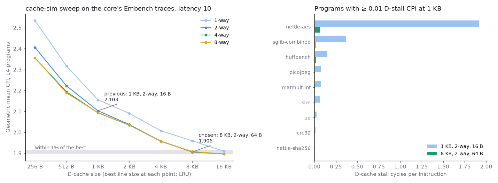

# Using cachesim to choose a hardware data cache

## Question

Once cachesim matches a real RTL cache access for access, can it choose that cache's geometry and policy from real workloads, and does the hardware confirm the choice?

## Concept

**Trace-driven design-space exploration.** A processor's sequence of data addresses doesn't change with the cache; only the timing does. One hardware simulation per program therefore yields a trace that a software model can replay under hundreds of cache configurations in seconds each. That's only trustworthy if the model has been validated against the hardware, which is what the earlier access-by-access check did.

**From misses to cycles.** The RTL cache's stall per miss is fixed by design: memory latency plus W + 3 cycles for a line of W words, and W + 1 more if the victim is dirty. Miss and writeback counts from the model then predict the stall cycles exactly.

**Why the geometric mean.** Programs run for very different lengths, and CPI is a ratio. A geometric mean of CPI weights each program equally, so one long program can't dominate the choice.

## What I tried

- The rv32i-pipeline core ran 14 Embench-IoT programs and wrote each one's data trace.
- cachesim replayed every trace at 240 points: 7 sizes, 4 associativities, 3 line sizes, and LRU, SRRIP and BRRIP.
- The choice was the smallest size within 1% of the best mean CPI, then the fewest ways, then the lowest CPI.
- The core was rebuilt with the chosen cache and measured.

## Output



(Figure from rv32i-pipeline `scripts/sweep_figure.py`.) The RTL run of nettle-aes at the chosen geometry:

```
PASS build/embench/nettle-aes.hex cycles=5654645 instret=4472479 CPI=1.264 fetches=4509331 fills=53225 daccesses=873304 dhits=863812 dmisses=9492 dwritebacks=1040
STACK cycles=5654646 instret=4472480 fill=4 loaduse=0 flush=75774 icmiss=813440 dcmiss=292948
```

cachesim predicted 9,492 misses, 1,040 writebacks and 292,948 stall cycles for that run, exactly what the hardware counted.

## Result

- Chosen: 8 KB, 2-way, 64 B lines, LRU. The mean CPI falls from 2.103 (1 KB) to 1.914 measured.
- Misses, writebacks and data-stall cycles matched on all 14 programs.
- Policy barely matters at these sizes: from 1 KB up, neither RRIP variant beats LRU by more than 0.4%.
- Limit found: total cycles were up to 1.8% above the prediction. Instruction fills overlap data stalls in the core, and a single-cache model can't see that overlap.

## Next

Model the instruction cache too. Instruction misses are now three quarters of the core's lost cycles.
