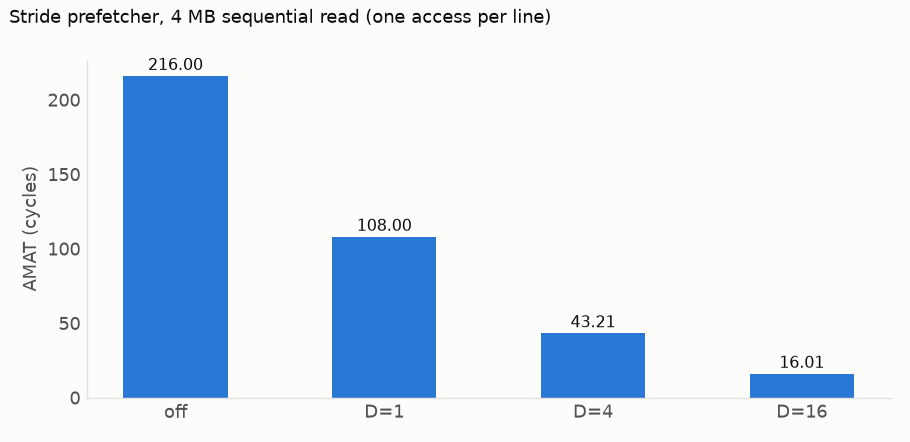

# Stride prefetcher

`--prefetch D` adds a stride prefetcher at the last level. Traces carry no PC, so it tracks one global stream of triggers: demand misses and first demand hits on prefetched lines. When consecutive triggers repeat a stride `s`, it fetches the next `D` blocks along `s`. A prefetch issued at cycle `t` lands at `t + 200`; a demand that arrives earlier waits for the rest (**late**). Bandwidth is unlimited.

Accuracy = useful / issued; coverage = useful / (useful + demand misses); lateness = late / useful.

L1 32 KB, L2 256 KB, both 8-way, 64 B lines, LRU, latencies 4/12/200. `seq64`: 4 MB read once, one access per line; `seq4`: 1 MB, one per float.

| Trace | AMAT, off | AMAT, D=4 | Accuracy | Coverage | Lateness |
|---|---:|---:|---:|---:|---:|
| `seq64` | 216.00 | 43.21 | 99.99% | 100.00% | 20.00% |
| `seq4` | 17.25 | 4.75 | 99.98% | 99.98% | 0.00% |
| matmul 128 `ijk` | 10.22 | 10.08 | 98.60% | 98.54% | 8.89% |
| matmul 128 `ikj` | 4.35 | 4.25 | 99.48% | 98.93% | 0.00% |
| matmul 128 tiled | 4.17 | 4.13 | 96.62% | 32.58% | 20.18% |
| matmul 256 `ijk` | 14.14 | 12.48 | 55.60% | 41.30% | 0.40% |
| `random` 1 MB | 165.84 | 165.84 | 10.53% | 0.00% | 0.00% |

AMAT by degree, D = off/1/4/16: `seq64` 216.00/108.00/43.21/16.01; matmul 256 `ijk` 14.14/12.80/12.48/14.17.

- **`seq64`**: a new line every 16 cycles, so D lines ahead hide 16·D of the 200 cycles. D=16 hides all of it; smaller D is late.
- **`seq4`**: 64 cycles per line; D=4 is on time.
- **matmul 128**: L2 rarely misses; the cost left is L1 misses, out of an L2 prefetcher's reach. Tiled streams are 2 lines long: low coverage.
- **matmul 256 `ijk`**: B's 1 KB column stride maps it into 32 L2 sets. At D=16, 84% of prefetches land past the end of B in those same sets and evict the column before `j+1` reuses it.
- **`random`**: no stride to find.
