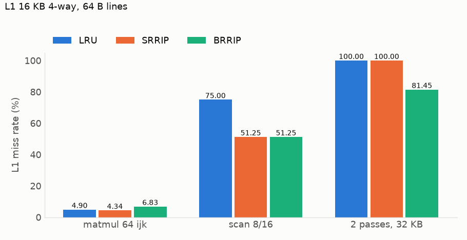

# RRIP replacement

`--policy srrip|brrip`. Each line holds a 2-bit re-reference prediction value (RRPV): 0 means "reused soon", 3 "reused far away". A hit sets 0. A miss evicts the first line at 3; if none is, the whole set ages until one is.

- **SRRIP** inserts at 2: a new line must hit once to outrank reused lines, so a short scan evicts itself, not the working set.
- **BRRIP** inserts at 3 (every 32nd fill at 2): new lines are the next victims, so a working set larger than the cache keeps the lines it holds.

Miss rate, 16 KB, 4-way, 64 B lines; 64×64 matmul. `scan H/S`: read H KB twice, scan S KB of new memory; 20 rounds.

| Trace | LRU | SRRIP | BRRIP |
|---|---:|---:|---:|
| matmul `ijk` | 4.90% | 4.34% | 6.83% |
| matmul `ikj` | 0.35% | 0.32% | 0.35% |
| matmul tiled | 0.32% | 0.32% | 0.33% |
| 2 passes, 32 KB | 100.00% | 100.00% | 81.45% |
| `scan 8/16` | 75.00% | 51.25% | 51.25% |
| `scan 8/32` | 83.33% | 83.33% | 72.51% |

- **`scan 8/16`**: hot set plus scan overflow the cache. LRU loses the hot set every round; under RRIP hot lines sit at 0 and the scan replaces itself (50% is the floor).
- **`scan 8/32`**: eight scan lines per set age the hot lines to 3, so SRRIP falls to LRU. BRRIP keeps some: scan lines enter at 3.
- **2 passes**: LRU and SRRIP evict each line just before reuse. BRRIP keeps 3 of 8 lines per set, so 3/16 of accesses hit.
- **`ijk`**: B's column lines are reused by column `j+1`. BRRIP evicts them first (B misses 17,632 → 31,610). SRRIP protects the A row, reused every `j` (A misses 4,164 → 432).
- **`ikj`, tiled**: the working set fits.
