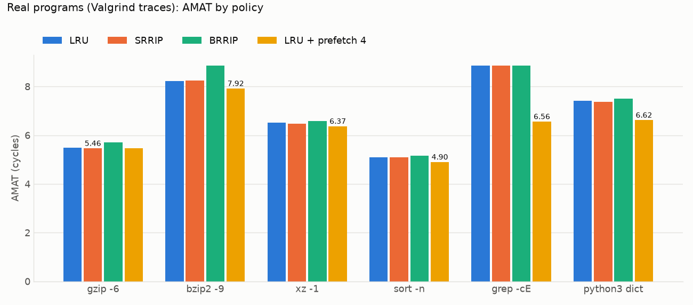

# Real program traces

`tools/real_traces.sh` runs six programs under Valgrind Lackey (`--trace-mem=yes`), converts loads and stores with `tools/lackey2trace.py` (instruction fetches dropped), and prints the table below. Traces (0.002–3 GB each) stay in `build/traces`, out of Git. Captured with Valgrind 3.27.1 on Ubuntu 26.04 (x86-64); inputs are 1 MB of `/usr/include` headers (gzip, bzip2, xz, grep) and 200,000 random integers (sort). Each trace includes the program's start-up.

L1 32 KB, L2 256 KB, both 8-way, 64 B lines, latencies 4/12/200. AMAT in cycles.

| Program | Accesses | L1 miss | L2 miss | LRU | SRRIP | BRRIP | LRU + prefetch 4 |
|---|---:|---:|---:|---:|---:|---:|---:|
| `gzip -6` | 31.5 M | 11.51% | 0.42% | 5.49 | 5.46 | 5.70 | 5.46 |
| `bzip2 -9` | 162.5 M | 3.41% | 43.86% | 8.23 | 8.25 | 8.86 | 7.92 |
| `xz -1` | 73.6 M | 3.00% | 22.30% | 6.51 | 6.47 | 6.58 | 6.37 |
| `sort -n` | 270.3 M | 0.70% | 43.49% | 5.09 | 5.09 | 5.16 | 4.90 |
| `grep -cE` | 0.19 M | 2.79% | 67.58% | 8.85 | 8.85 | 8.86 | 6.56 |
| `python3` dict | 169.9 M | 2.04% | 53.70% | 7.42 | 7.38 | 7.50 | 6.62 |

Prefetch (D=4) coverage: grep 56%, gzip 28%, python 26%, sort 19%, bzip2 9%, xz 7%.

An earlier capture with Valgrind 3.26 gave the same conclusions. Its numbers differ by up to 17% in accesses (python), because the programs and libraries on the host were updated in between, so the two captures are not a Valgrind comparison.

- **gzip**: its hash chains and window miss the 32 KB L1 often but fit in L2 (0.42% misses), so replacement and prefetching hardly matter.
- **SRRIP** stays within 0.05 cycles of LRU on every program, so these traces have little of the scan-over-hot-set pattern it protects against.
- **BRRIP** loses on every program. Inserting at "distant" evicts new lines before their reuse (gzip L1 misses 11.51% → 13.31%, xz 3.00% → 3.09%). Real designs only use it inside DRRIP, which duels BRRIP against SRRIP per set.
- **Prefetching** pays where the misses are a sequential scan: grep's input buffer (L2 misses 67.58% → 29.87%) and python (53.70% → 39.86%). sort's merges stream through runs, so it covers a fifth of its misses; bzip2's suffix sorting and xz's match finder touch memory in data-dependent order, so a single stride stream finds little.
